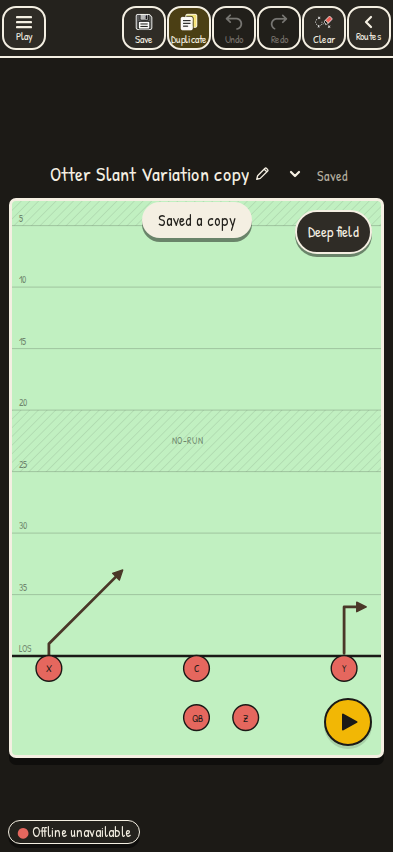
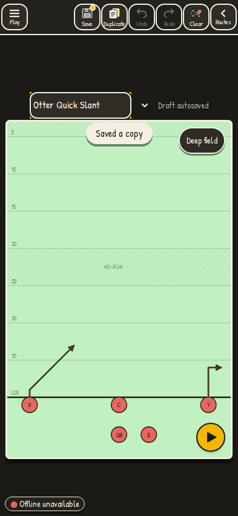
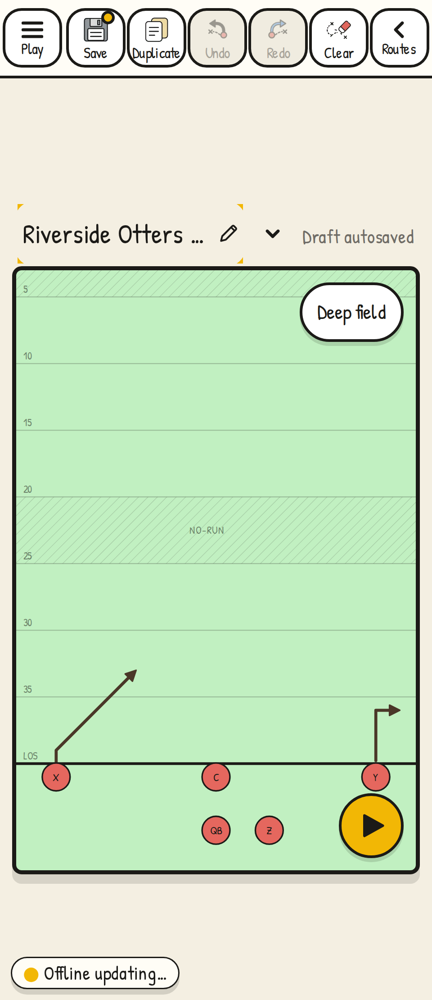
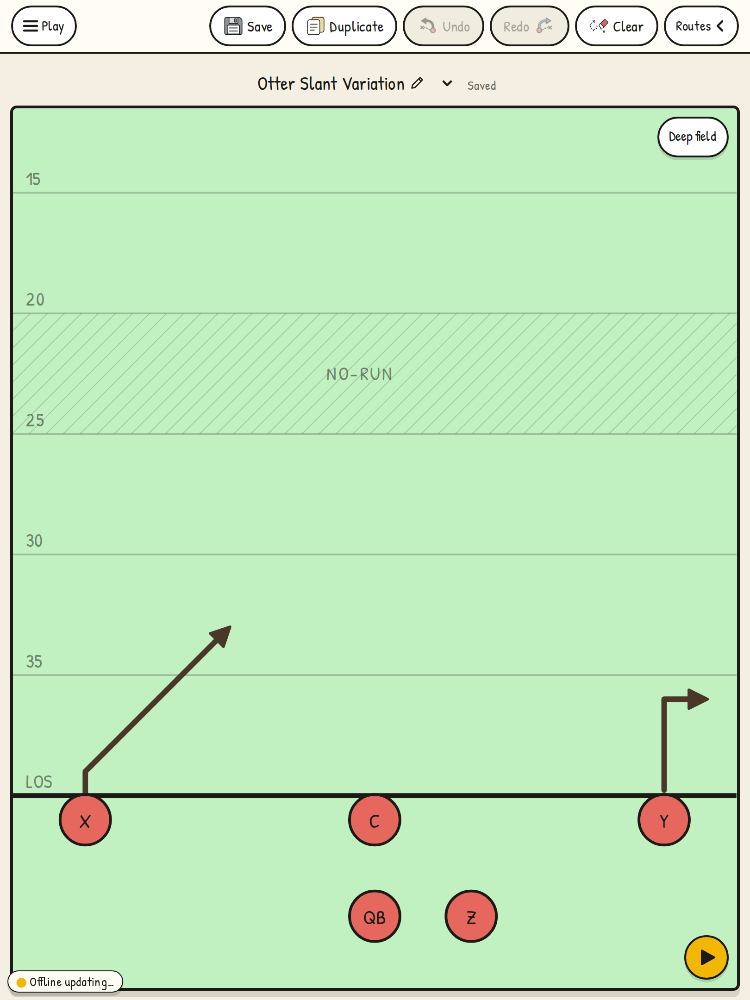

# Duplicate and rename from the main screen

The header's **Duplicate** saves a new play with ` copy` appended and opens that copy for editing. It preserves the current diagram and notes, including changes not yet saved, while leaving the original library record alone.

Tap the title or pencil above the field to rename. Enter or leaving the input finishes editing; Escape restores the name from before editing. Changes use the same draft and Save behavior as Play tools, including Ctrl+S / ⌘S while typing. Roster and shared views keep plain titles.

The header stays on one row with seven controls, each at least 44×44 CSS pixels, at 320, 375, 393, 480, 600, 768 and 810 pixels. A failed duplicate opens the storage warning; **Try again** retries creating a copy.

## Verification

Production build, ESLint and TypeScript passed. The save, history, playbook switching and new header journeys passed 76 checks across desktop, Pixel 7, iPhone 15 and iPad Chromium projects. After the final responsive and retry refinements, the header editing and header save journeys passed all 32 checks again.

Repeat the final browser checks with:

```sh
bun run build
bun run test:e2e e2e/journeys/header-edit.journey.ts e2e/journeys/header-save.journey.ts --workers=2
```

`header-edit` in CI retains screenshots and stored-play/geometry JSON manifests. These projects emulate devices in Chromium; they do not establish real Safari behavior.

The tour was refreshed against the production build, with one isolated chapter and two successful complete captures. Each set passed coverage, duration, codec and resolution checks: 1,880,468 and 1,900,655 bytes, both below the unchanged 2 MB limit. The published files all come from the first complete set. A validation summary is alongside this note. Slightly longer reading pauses in the league rules and wristband chapters and CRF 53/38 keep the clips within their timing and size limits.

## Screenshots

Dark phone layout and inline rename:





Phone at 320 CSS pixels, with a long name:



iPad portrait, after duplicating, renaming, saving and reloading:


