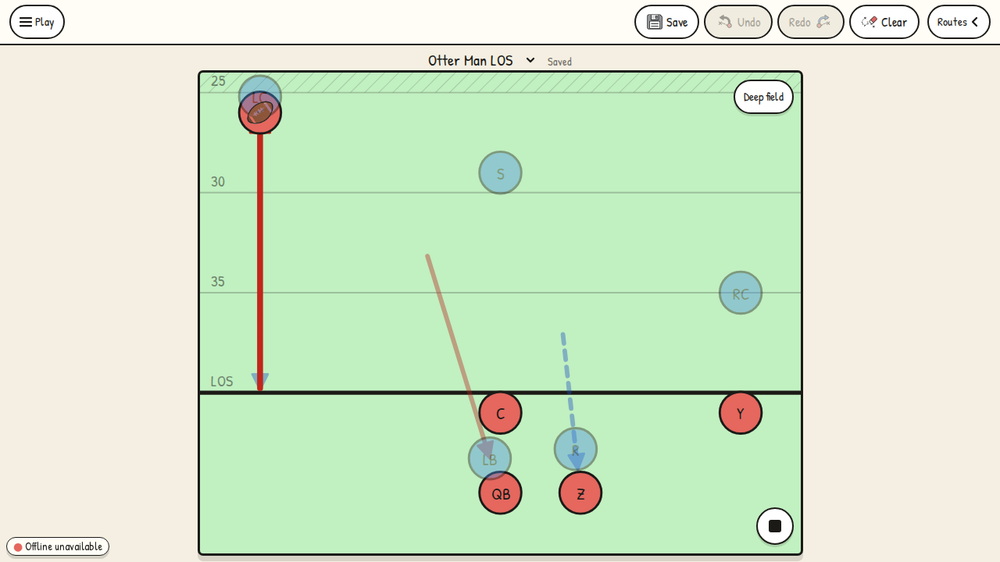
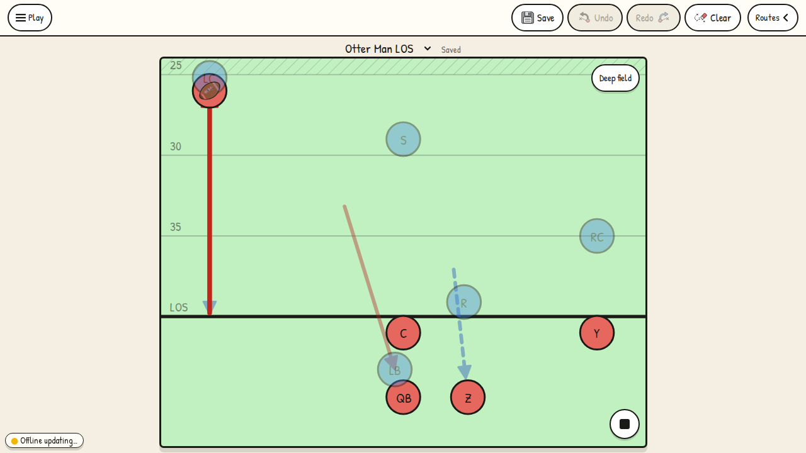

# Man coverage holds the LOS

The same stationary backfield receiver was played before and after the fix. Previously
the man defender followed them 2.81 yards into the backfield without a handoff. Now the
defender stops 0.9 yards on the defensive side, using the formation's existing LOS gap.
Negative y is the defensive side; positive y is the offensive backfield.

| Before | After |
| --- | --- |
|  |  |

The position samples are in `before-pass.json` and `after-pass.json`. Phone screenshots
show the same pass restriction (`phone-pass.png`) and permitted pursuit after a real
handoff (`phone-handoff.png`). Fixtures are fictional Riverside Otters plays.

Validation:

- `bun run test:e2e e2e/journeys/man-los.journey.ts --workers=2`: 28 passed, seven cases
  across desktop Chromium, Pixel 7, iPhone 15 and iPad emulation. Every case records the
  rendered token positions throughout playback and a final screenshot. This does not
  establish real-device Safari behavior.
- The new pass case failed against the original production build before the fix.
- `bun test`: 339 passed, 7 Redis integration tests skipped without Redis configured.
- ESLint, TypeScript and the production build passed.

The tests hold man coverage through passes, retreating routes, play-action fakes and QB
keepers, release after completed handoffs (including jet sweeps and pre-snap motion),
and preserve downfield coverage and the assigned blitz. CI uploads all case traces and
screenshots as the `man-los` artifact.
